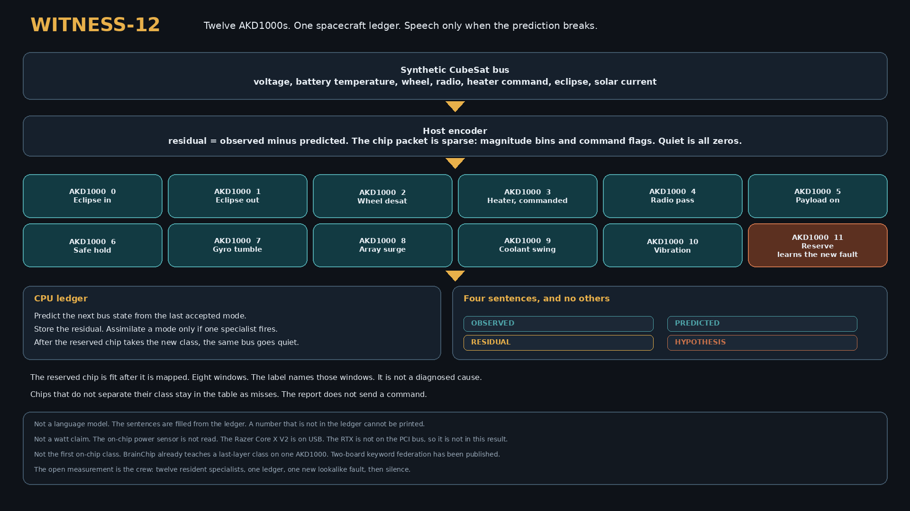

# Witness-12

Twelve physical BrainChip AKD1000 processors, one spacecraft state ledger, and a language report that can print a number only when that number already exists in the ledger.

The bus is synthetic. Nothing in this repository was downlinked from orbit, and nothing here is a flight result. The chip table in [`witness12/results/board.json`](witness12/results/board.json) is one `hw_only` run on a 12-card host. The on-chip power meter was not called. There is no watt figure in this repository.



The long-form design, packet layouts, learning rule, and the full score table are in [TECHNICAL_OMNIBUS.md](TECHNICAL_OMNIBUS.md).

## What the system is

A conventional language model reads a description of a spacecraft and talks. Witness-12 keeps a small physical state, predicts the next sample from the last accepted mode, and turns the residual into spikes. Twelve AKD1000s are twelve specialists. Each one is its own mapped model. The host speaks in four claim types:

| Claim | What it is allowed to say |
| --- | --- |
| OBSERVED | Values taken from the current sample |
| PREDICTED | Values taken from the ledger's prediction |
| RESIDUAL | Standardized residuals of those channels |
| HYPOTHESIS | A label for the specialist that fired, plus the evidence that would keep or drop it |

An action line can recommend that an operator look at the heater and power lines. The program does not send a command.

The situation the reserved chip is asked to learn is a lookalike power fault: battery temperature up, bus voltage down, bus current up, heater command still low. A commanded heater has the same thermal and electrical shape with the command bit high.

## What one board run showed

Recorded on host hardware with Akida 2.19.3, driver-bound `/dev/akida0`–`/dev/akida11`, `akida.devices()` returning `PCIe/NSoC_v2/0` through `/11` in 20.7 seconds. Every model mapped with `hw_only`. Fit ran after the map. Batch size was 8. Details and every integer are in the omnibus and in `board.json`.

- All 12 chips held a resident model in one process.
- After the reserved chip (`PCIe/NSoC_v2/11`) was fit with eight windows of the new class, the other eleven chips returned the same control potentials they had returned before that fit.
- A quiet packet scored zero on every chip, before and after the reserved fit.
- On the novel windows, the new-class potential rose from 24 to 36 and became the argmax.
- On the commanded-heater windows, the new-class potential rose from 51 to 61, so the lookalike also became the new class. The reserved chip did not keep the two heater situations apart.
- Five of the eleven binary specialists met the separation rule (own class wins on its event, rival class wins on the rival event, quiet stays at zero): eclipse exit, radio pass, payload on, safe hold, vibration. Six did not.

The host transcript from `python -m witness12` is a separate exact-mask decoder. It withholds the fault name until the class is stored, then goes silent on the next identical sample. That transcript is not the chip table.

## Run the host decoder

The host path needs Python 3 and NumPy. It does not open `/dev/akida`.

```bash
python -m witness12
python -m witness12.test_host
```

`test_host` checks the silence pattern, the withheld fault name, and that every number printed in a claim was copied from that claim's number list.

## Run the chips

`python -m witness12.run_board` maps one model per device, fits on the chip, and rewrites `witness12/results/board.json`. Requirements that are specific to the machine that produced the recorded run:

- BrainChip AKD1000s visible as `/dev/akida*`
- Akida Python SDK 2.19.3 (MetaTF), the environment used for the recorded run
- One process. The runtime takes an exclusive file lock across the device nodes.
- Batch size 8. Larger forwards on this host have timed out.
- Do not call the on-chip power-meter API. On this host that call fails initialization and then stalls forwards.

The recorded run did not reload the driver and did not read chip power.

## Layout

```
README.md                 this file
TECHNICAL_OMNIBUS.md      design, formats, protocol, full scores
witness12/
  codec.py                512-bit dense packet used by the host ledger
  sparse.py               256-bit sparse packet used by the chips
  catalog.py              12 specialists, synthetic bus, host decoder
  ledger.py               prediction and mode assimilation
  language.py             claim-typed sentences
  engine.py               timeline
  akida_backend.py        MetaTF model builder (software forward)
  run_board.py            hw_only map, on-chip fit, JSON report
  test_host.py            host checks
  test_akida_sim.py       optional dense-packet probe, off by default
  draw_architecture.py    redraws architecture.png
  architecture.png
  results/board.json      the recorded 12-chip run
```

## Scope of the recorded hardware

The host that produced `board.json` is a BIOSTAR TB250-BTC PRO with twelve AKD1000 cards, each link Gen2 x1, Akida IP v1, 78 neural processors, 300 MHz clock, reported version `BC.00.000.002`. A Razer Core X V2 enclosure was visible on USB during the work. The discrete GPU inside it was not on the PCI bus and is not part of the result.

Akida 1.0 on-chip learning, as used here, is the last layer only: `FullyConnected`, 1-bit weights, 1-bit input, `AkidaUnsupervised` in labeled mode. The world-model prediction stays on the CPU. The chips classify spike packets.
